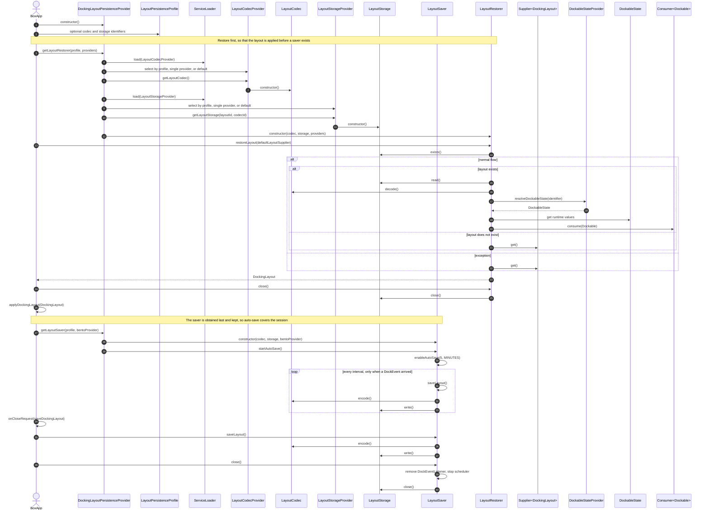
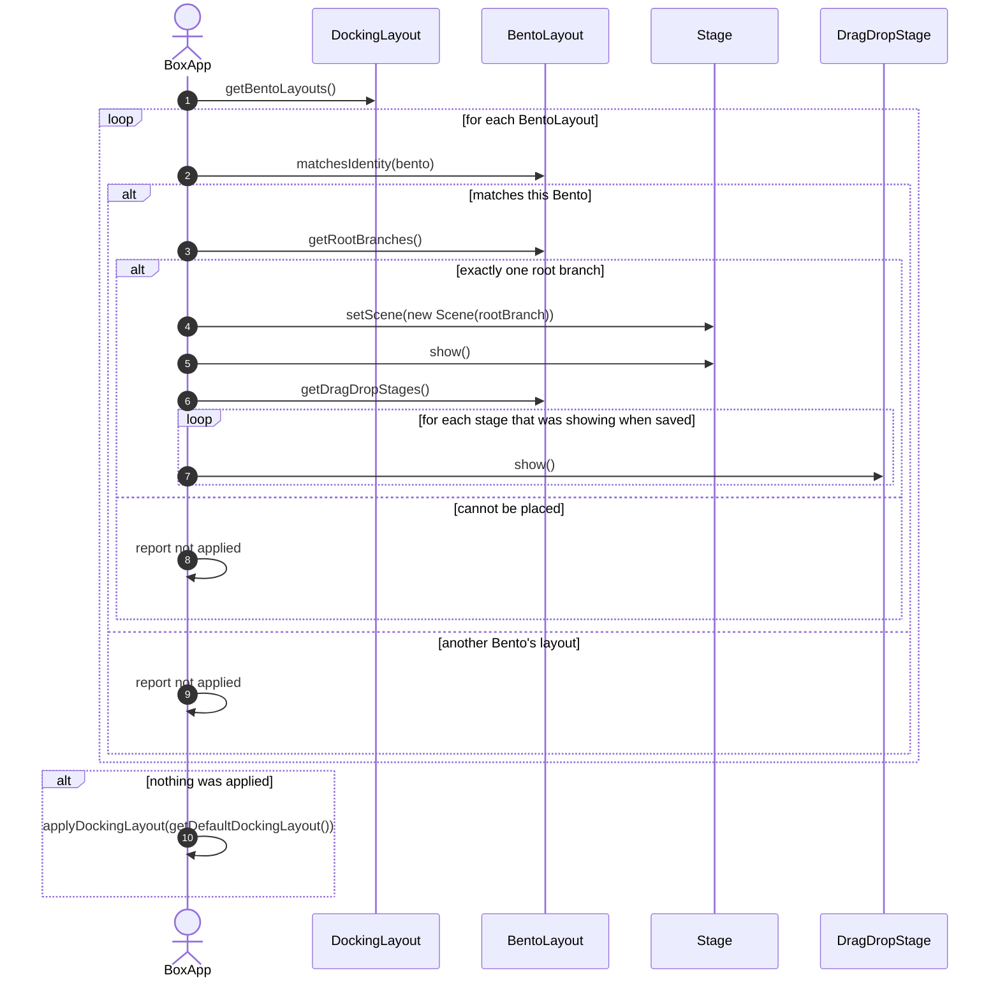

# Docking Layout Persistence Implementation

This document describes BentoFX layout persistence as implemented by
[DockingLayoutSaver](../../persistence/core/src/main/java/software/coley/bentofx/persistence/core/impl/DockingLayoutSaver.java)
and [DockingLayoutRestorer](../../persistence/core/src/main/java/software/coley/bentofx/persistence/core/impl/DockingLayoutRestorer.java).

For a high-level architectural overview, see the [BentoFX Persistence guide](guide.md).

## Scope

This document covers the internal collaborators, the save and restore algorithms, and the sequence diagrams. For the application-facing API, see the [guide](guide.md) and [providers](providers.md).

## Key concepts

### Domain state model

Persistence is expressed as immutable-ish *state* objects rather than direct serialization of user interface classes:

- `DockingLayout` is the application-facing restored layout. It contains one or more `BentoLayout` instances.
- `BentoLayout` contains runtime `DockContainerRootBranch` and `DragDropStage` instances for a single `Bento`.
- `BentoState` is the serializable state for a persisted `Bento`.
- `PersistableLayout` is what a codec encodes and decodes: the `BentoState` list plus the layout-level metadata, which includes an optional display name and group. See [Managing Layouts](layouts.md) for how those are used.
- `DockContainerRootBranchState`, `DockContainerBranchState`, and `DockContainerLeafState` represent the container tree.
- `DockableState` represents the information needed to reconstruct a runtime `Dockable`.
- `DragDropStageState` represents secondary drag/drop stages and contains a root-branch state.

### Storage and codec

Round-trip persistence is a multistep, pipelined process. 

1. The application adds one or more `LayoutCodecProvider` implementations to make persisted formats available.
2. The application adds one or more `LayoutStorageProvider` implementations to make storage destinations available.
3. The default persistence provider selects codec and storage providers by explicit `LayoutPersistenceProfile`
   identifiers, by a single available provider, or by a single default provider.
4. `LayoutSaver` walks the current BentoFX container graph through a `BentoProvider`.
5. `LayoutSaver` builds serializable state, encodes it with `LayoutCodec`, and writes it with `LayoutStorage`.
6. `LayoutRestorer` reads state with `LayoutStorage`, decodes it with `LayoutCodec`, and rebuilds runtime layout objects.
7. The application applies the returned `DockingLayout` to its stages.

For concrete implementations of these roles, review the bundled implementations:   

<u>**Codec**</u>   
[JsonLayoutCodecProvider](../../persistence/codec/json/src/main/java/software/coley/bentofx/persistence/impl/codec/json/provider/JsonLayoutCodecProvider.java)   
[XmlLayoutCodecProvider](../../persistence/codec/xml/src/main/java/software/coley/bentofx/persistence/impl/codec/xml/provider/XmlLayoutCodecProvider.java)

<u>**Storage**</u>   
[FileLayoutStorageProvider](../../persistence/storage/file/src/main/java/software/coley/bentofx/persistence/impl/storage/file/provider/FileLayoutStorageProvider.java)   
[DatabaseLayoutStorageProvider](../../persistence/storage/db/h2/src/main/java/software/coley/bentofx/persistence/impl/storage/db/provider/DatabaseLayoutStorageProvider.java)

You can also refer to the [persistence guide](guide.md) for the full list of bundled providers.

## Internal process flow

`DockingLayoutSaver` and `DockingLayoutRestorer` are intentionally thin. The JavaFX threading boundaries remain in these public entry points, while the detailed work is delegated to smaller package-private collaborators:

| Collaborator | Responsibility | Threading expectation |
|--------------|----------------|-----------------------|
| `DefaultBentoStateCapturer` | Walks live BentoFX objects and builds serializable `BentoState` instances. | JavaFX application thread. |
| `LayoutStateWriter` | Encodes captured state with `LayoutCodec` and writes it with `LayoutStorage`. | Off the JavaFX application thread. |
| `LayoutStateReader` | Reads persisted layouts with `LayoutStorage` and decodes them with `LayoutCodec`. | Off the JavaFX application thread. |
| `DefaultDockingLayoutRebuilder` | Rebuilds live BentoFX objects from decoded state and application providers. | JavaFX application thread. |

This split keeps the public saver/restorer API stable while making the persistence pipeline easier to test. Unit tests can cover storage/codec error handling through `LayoutStateReader` and `LayoutStateWriter` without creating JavaFX stages,
and graphical integration tests can continue to cover full end-to-end save and restore behavior.

## Persistence startup sequence

The sequence below shows the full startup lifecycle: first restore so the layout is applied before a saver exists, then obtain the saver so auto-save persists layout changes over the life of the application session.

## Saving the layout design

`LayoutSaver.saveLayout()` persists the current state of every `Bento` the `BentoProvider` returns. The default implementation, [DockingLayoutSaver](../../persistence/core/src/main/java/software/coley/bentofx/persistence/core/impl/DockingLayoutSaver.java), extends [AbstractAutoCloseableLayoutSaver](../../persistence/core/src/main/java/software/coley/bentofx/persistence/core/impl/AbstractAutoCloseableLayoutSaver.java).

### Automatic scheduled saving

A saver obtained from a `DockingLayoutPersistenceProvider` is initialized with auto-saving enabled at the default five-minute interval. The auto-save process is change-aware, meaning the saver listens for `DockEvent` on every `Bento`, records when a `DockEvent` occurs, and on the expiration of each interval writes the current layout if a `DockEvent` has occurred since the last save. This process ensures unchanged layouts are not rewritten.

`AbstractAutoCloseableLayoutSaver` deliberately does not start auto-save from its constructor. Doing so publishes a partly-built object to a scheduler thread and to every `Bento` event bus before subclass fields are assigned, so a save firing in that window could observe a half-built saver. Instead, the provider calls `startAutoSave(...)` once construction is complete. A directly instantiated saver can be initialized with `enableAutoSave(long, TimeUnit)`.

The application-facing lifecycle - obtaining the saver after the layout is applied, saving on close, and closing the saver - is covered under [Saving the Layout](guide.md#saving-the-layout).

### How the container tree is captured

The saver uses `BentoProvider` to walk each `Bento` container graph and converts runtime objects to state objects:

- `Bento` -> `BentoState`
- `DragDropStage` -> `DragDropStageState`
- `DockContainerRootBranch` -> `DockContainerRootBranchState`
- `DockContainerBranch` -> `DockContainerBranchState`
- `DockContainerLeaf` -> `DockContainerLeafState`
- `Dockable` -> `DockableState`

### Error handling philosophy

- Saver attempts to build each state independently; failure to build one state should not prevent building others.
- Encoding and streaming failures are treated as fatal and reported through `BentoStateException`.

## Restoring the layout design

### High-level algorithm

`LayoutRestorer.restoreLayout(Supplier<DockingLayout> defaultLayoutSupplier)` returns an application-facing `DockingLayout`.

The default implementation:

1. Checks whether persisted layout storage exists.
2. If persisted layout storage does not exist, returns the layout from `defaultLayoutSupplier`.
3. If persisted layout storage exists, reads and decodes `BentoState`.
4. For each `BentoState`:
   - resolves the matching runtime `Bento` through `BentoProvider`
   - uses the `Bento`'s `DockBuilding` to recreate root branches, branches, leaves, and dockables
   - uses `DockableStateProvider` to resolve dockables by identifier
   - uses `DockContainerLeafMenuFactoryProvider` to restore leaf menu factories when available
   - creates a `BentoLayout` containing restored root branches and drag/drop stages
5. For each `DragDropStageState`:
   - restores the drag/drop stage root branch
   - uses `StageIconImageProvider` to restore stage icons when available
   - applies persisted stage geometry and other stage properties
6. Returns a `DockingLayout` containing the restored `BentoLayout` instances.

The application is responsible for applying the returned `DockingLayout` (see [Restoring the Layout](guide.md#restoring-the-layout)).

### How dockables are restored

Restoration resolves dockables by identifier:

1. Each persisted dockable state supplies an identifier.
2. `DockableStateProvider.resolveDockableState(identifier)` returns the application-owned `DockableState`.
3. The restorer creates a runtime `Dockable` using the current `Bento`'s `DockBuilding`.
4. Optional `DockableState` values are applied to the runtime `Dockable`.
5. The dockable is added to the restored leaf.
6. Selected dockable identifiers are applied after dockables have been added.

Fallback behavior, error handling, and the application-facing restore lifecycle are covered under [Restoring the Layout](guide.md#restoring-the-layout).

### Applying a restored layout

The diagram below shows the fallback logic for applying a `DockingLayout`, including the per-`BentoLayout` matching and the default-layout recovery.

## Basic demo vs persistence demo

| Concern | Basic demo | Persistence demo |
|---------|------------|------------------|
| Bento identity | Uses a default `Bento`. | Uses a `Bento` with a stable identifier. |
| Layout creation | Builds the runtime container tree directly in `start(Stage)`. | Builds a default `DockingLayout`, then restores or applies a `DockingLayout`. |
| Dockable creation | Creates dockables inline. | Resolves `DockableState` by stable identifier through `DockableStateProvider`. |
| Source of truth for dockables | Startup code. | Provider implementations. |
| Dockable placement | Placement is hard-coded during startup. | Default placement is hard-coded, but restored placement comes from persisted layout state. |
| Menus | Menu factories are set directly. | Menu factories are supplied by providers so restored objects receive the same behavior. |
| Stage handling | Creates and shows the primary scene directly. | Applies the restored `BentoLayout` to the stage and shows restored drag/drop stages, falling back to the default layout when none can be applied. |
| Shutdown behavior | Exits on hidden. | Saves the docking layout on close request, then closes the saver, both before stages are closed. Also offers `File > Exit`, which saves explicitly because closing a stage in code raises no close request. |
| Application menus | None. The scene root is the docking root branch. | A `MenuBar` above the docking area, so the scene root is a `VBox`. The basic demo has no menu bar because it has no application-level commands to offer. |
| Named layouts | None. | `Window > Layouts` saves the layout showing under a name, and restores, renames or deletes a stored one. Switching happens live, so the demo also owns taking auto-save down around the switch, and writing the outgoing arrangement to the session layout on the way out. |

## See also

- [BentoFX Persistence guide](guide.md) - the application-facing guide.
